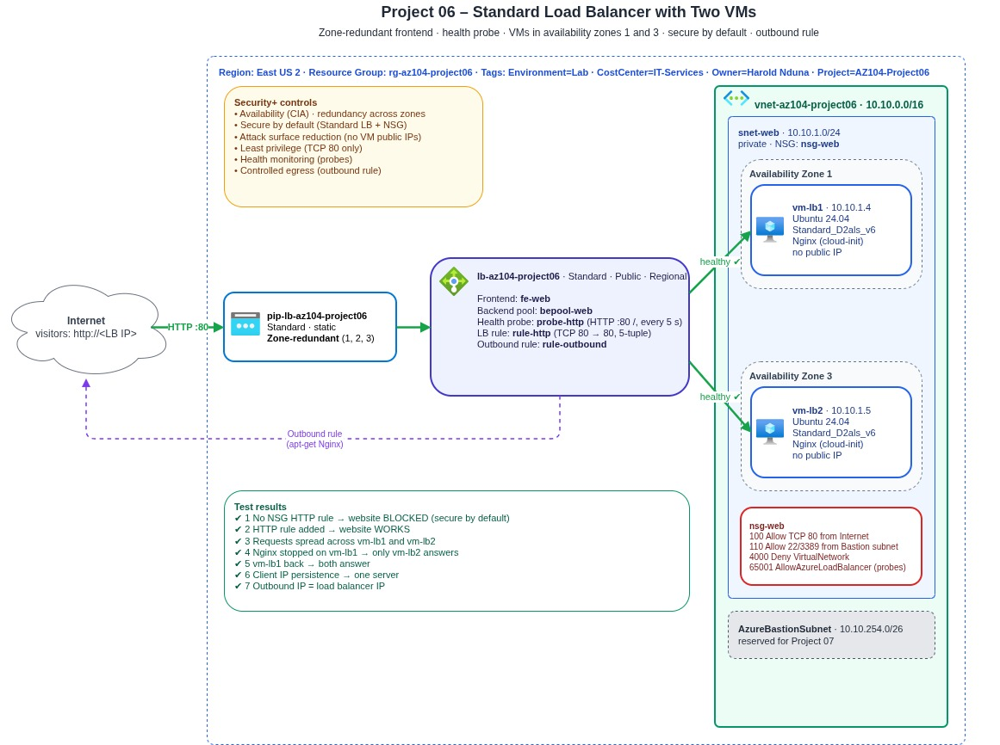

# Project 06 – Standard Load Balancer with Two VMs (Security+ Aligned)

## Overview

This project puts **two identical web servers in different availability zones behind one Standard Load Balancer**. Visitors only ever see one public IP address; the load balancer spreads requests across the servers, checks their health every five seconds, and stops sending traffic to a server that fails.

The headline result: **a web server was stopped and the website stayed up.**

```
                        ┌──────────────── Zone 1 ── vm-lb1 (Nginx) ✔
Internet ──▶ Public IP ──▶ Load balancer ─┤
  (zone-redundant)      (health probe)   └──────────────── Zone 3 ── vm-lb2 (Nginx) ✔
```

It also shows that the **Standard Load Balancer is secure by default**: the website stayed unreachable until an NSG rule explicitly allowed HTTP.

## Project Objectives

- Deploy a **Standard, public** Azure Load Balancer with a **zone-redundant** frontend IP
- Configure a **backend pool**, an **HTTP health probe**, a **load-balancing rule** and an **outbound rule**
- Place two VMs in **different availability zones** with no public IPs
- Prove **secure by default**, **distribution**, **failover**, **recovery** and **session persistence** with real traffic
- Provide outbound internet through a **load balancer outbound rule** (compare with Project 05's NAT Gateway)
- Build it in the Azure Portal, then with Azure CLI, Bicep/ARM and PowerShell

## How It Works – The Office Building Analogy

| Azure | Office building |
|---|---|
| Load balancer | The **receptionist** at the main entrance, directing each visitor to a member of staff |
| Frontend IP (public IP) | The building's **one public phone number / entrance** |
| Backend pool | The **team of identical staff** who can all handle the same request |
| Health probe | The receptionist **checking every few seconds that each desk is staffed** |
| Load-balancing rule | *"Visitors asking for the website (port 80) go to the web team"* |
| Session persistence | Sending a returning visitor back to **the same person** |
| Outbound rule | The building's **shared outgoing phone line** |
| Inbound NAT rule | A **direct extension** to one person (optional – not performed) |
| Standard SKU, secure by default | The **entrance stays locked** until the floor guard (NSG) is told to let visitors in |
| Availability zones | Staff placed in **different buildings** across the city |

## Architecture



| Component | Name | Details |
|---|---|---|
| Region | East US 2 | |
| Resource group | `rg-az104-project06` | Tagged: Environment, CostCenter, Owner, Project |
| VNet / subnet | `vnet-az104-project06` / `snet-web` | 10.10.0.0/16 / 10.10.1.0/24, private, `nsg-web` |
| Reserved subnet | `AzureBastionSubnet` | 10.10.254.0/26 – for Project 07 |
| Public IP | `pip-lb-az104-project06` | Standard, static, **zone-redundant** (zones 1, 2, 3) |
| Load balancer | `lb-az104-project06` | **Standard, public, regional** |
| Frontend | `fe-web` | → pip-lb-az104-project06 |
| Backend pool | `bepool-web` | NICs of vm-lb1 and vm-lb2 |
| Health probe | `probe-http` | HTTP, port 80, path `/`, every 5 s |
| Load-balancing rule | `rule-http` | TCP 80 → 80, 5-tuple distribution, outbound SNAT disabled |
| Outbound rule | `rule-outbound` | All protocols, 10,000 ports per instance |
| **vm-lb1** | 10.10.1.4 | **Zone 1**, Ubuntu 24.04, Standard_D2als_v6, no public IP, Nginx via cloud-init |
| **vm-lb2** | 10.10.1.5 | **Zone 3**, Ubuntu 24.04, Standard_D2als_v6, no public IP, Nginx via cloud-init |

### NSG Rule Audit (`nsg-web`)

| Priority | Name | Source | Destination | Port | Action | Why |
|---|---|---|---|---|---|---|
| 100 | Allow-HTTP-Internet | Internet | 10.10.1.0/24 | TCP 80 | Allow | Lets web visitors through the load balancer – added *after* the secure-by-default test |
| 110 | Allow-Mgmt-Bastion | 10.10.254.0/26 | 10.10.1.0/24 | TCP 22, 3389 | Allow | Admin access only from the management subnet |
| 4000 | Deny-VNet-Inbound | VirtualNetwork | Any | Any | **Deny** | Blocks lateral movement |
| 65001 | AllowAzureLoadBalancerInBound *(default)* | AzureLoadBalancer | Any | Any | Allow | Lets the **health probes** (168.63.129.16) reach the VMs |

The rule's destination is the **VM subnet**, not the load balancer: the load balancer passes traffic through, keeping the visitor's real source IP, and the NSG on the VMs' subnet decides.

## Security+ Alignment

| Security+ concept | How this project demonstrates it |
|---|---|
| **Availability (CIA triad)** | The website kept working when a server failed |
| **Redundancy / fault tolerance** | Two identical servers in **different availability zones**; zone-redundant frontend |
| **Secure by default** | Standard Load Balancer blocks traffic until an NSG explicitly allows it |
| **Attack surface reduction** | One public entry point; no public IPs on the servers |
| **Least privilege** | Only TCP 80 from the internet; management only from the reserved subnet |
| **Health monitoring** | HTTP probes detect failure in seconds and remove the failed server automatically |
| **Controlled egress** | Outbound internet only through the load balancer's outbound rule |
| **Risk management** | The optional inbound NAT rule (SSH from the internet) was deliberately **not** performed – Bastion (Project 07) is the safer pattern |
| **Configuration management** | Both servers built identically by cloud-init |
| **Asset management** | Every resource tagged with Environment, CostCenter, Owner, Project |

## Tools Used

| Tool | Purpose |
|---|---|
| Azure Portal | Manual build and tests |
| Azure CLI (Bash) | `deploy.sh`, `test-lb.sh`, `cleanup.sh` |
| Bicep / ARM | `main.bicep`, `azuredeploy.json` |
| Azure PowerShell | `deploy.ps1` (reference) |
| cloud-init | Installs Nginx and publishes a page showing server and zone |
| Run command | Checking and stopping/starting Nginx without SSH |
| Azure Monitor metrics | Health Probe Status per backend |
| curl | Sending real requests from the internet |
| draw.io | Architecture diagram |

## Repository Contents

| File | Description |
|---|---|
| `deploy.sh` | Azure CLI deployment with zone fallback and verification output |
| `test-lb.sh` | Runs Tests 1–7 automatically and saves `test-results.txt` |
| `cleanup.sh` | Safe teardown with typed confirmation |
| `main.bicep` / `azuredeploy.json` | Bicep and compiled ARM template (final state, HTTP rule included) |
| `parameters.json` | Parameters (the SSH public key is passed at deploy time) |
| `deploy.ps1` | Azure PowerShell equivalent |
| `scripts/cloud-init-web.yaml` | First-boot config: Nginx + "Served by / zone" page |
| `notes-tips-tricks.md` | AZ-104 exam notes on load balancing |
| `architecture-diagram.drawio` / `.png` | Architecture diagram |
| `test-results.txt` | Output of `test-lb.sh` |
| `screenshots/gui/` | Portal build and test evidence |
| `screenshots/cli/` | CLI build and test evidence |

## Deployment Instructions

### Prerequisites

- Azure subscription, logged in: `az login --tenant <tenant-id>`
- Azure CLI and Git (Ubuntu or Cloud Shell)
- An SSH key at `~/.ssh/id_rsa` (`az vm create --generate-ssh-keys` creates one if missing)
- Check the VM size is allowed in zones: `az vm list-skus --location eastus2 --size Standard_D2als_v6 --all -o table`

### Cost

| Item | Approx. cost |
|---|---|
| 2 × Standard_D2als_v6 | ~$0.08/hour each |
| Standard Load Balancer (≤ 5 rules) | ~$0.025/hour + tiny per-GB charge |
| Standard public IP | ~$0.005/hour |
| **Total** | **~$0.19/hour** – the load balancer and IP bill even when the VMs are off |

### Method 1: Azure Portal

The project was first built by hand in the Azure Portal, in this order:

1. **Free:** resource group, NSG (without the HTTP rule), VNet and subnets.
2. **Charged from here:** zone-redundant public IP and Standard Load Balancer (frontend, backend pool, health probe, load-balancing rule, outbound rule).
3. Two VMs in zones 1 and 3, joined to the backend pool at creation, with `scripts/cloud-init-web.yaml` pasted into **Custom data**.
4. Tests 1–6 (below), then deletion of the resource group.

The portal evidence is in `screenshots/gui/`.

### Method 2: Azure CLI (Bash) – Primary

```bash
chmod +x deploy.sh test-lb.sh cleanup.sh
./deploy.sh        # ~10 minutes
sleep 180          # give cloud-init time to install Nginx
./test-lb.sh       # ~8 minutes, saves test-results.txt
./cleanup.sh
```

Key commands:

```bash
# Zone-redundant Standard public IP
az network public-ip create -g rg-az104-project06 -n pip-lb-az104-project06 \
  --sku Standard --allocation-method Static --zone 1 2 3

# Standard load balancer with frontend and backend pool
az network lb create -g rg-az104-project06 -n lb-az104-project06 --sku Standard \
  --public-ip-address pip-lb-az104-project06 --frontend-ip-name fe-web --backend-pool-name bepool-web

# Health probe, load-balancing rule, outbound rule
az network lb probe create -g rg-az104-project06 --lb-name lb-az104-project06 -n probe-http \
  --protocol Http --port 80 --path / --interval 5
az network lb rule create -g rg-az104-project06 --lb-name lb-az104-project06 -n rule-http \
  --protocol Tcp --frontend-port 80 --backend-port 80 --frontend-ip-name fe-web \
  --backend-pool-name bepool-web --probe-name probe-http --disable-outbound-snat true
az network lb outbound-rule create -g rg-az104-project06 --lb-name lb-az104-project06 -n rule-outbound \
  --frontend-ip-configs fe-web --address-pool bepool-web --protocol All --outbound-ports 10000

# NIC in the backend pool, then a VM in a specific zone
az network nic create -g rg-az104-project06 -n nic-vm-lb1 --vnet-name vnet-az104-project06 \
  --subnet snet-web --private-ip-address 10.10.1.4 --lb-name lb-az104-project06 --lb-address-pools bepool-web
az vm create -g rg-az104-project06 -n vm-lb1 --zone 1 --nics nic-vm-lb1 \
  --image Ubuntu2404 --size Standard_D2als_v6 --disk-controller-type NVMe \
  --custom-data "$PWD/scripts/cloud-init-web.yaml" --generate-ssh-keys

# Session persistence
az network lb rule update -g rg-az104-project06 --lb-name lb-az104-project06 -n rule-http \
  --load-distribution SourceIP     # Client IP   (Default = 5-tuple)
```

### Method 3: Bicep / ARM

```bash
az group create --name rg-az104-project06 --location eastus2
az deployment group create --resource-group rg-az104-project06 \
  --template-file main.bicep --parameters parameters.json \
  --parameters adminPublicKey="$(cat ~/.ssh/id_rsa.pub)"
```

### Method 4: Azure PowerShell

```powershell
./deploy.ps1
```

## Test Results

| # | Test | Expected | Result |
|---|---|---|---|
| 1 | No NSG HTTP rule → website | Blocked (secure by default) | ✅ |
| 2 | Allow-HTTP-Internet added → website | Works | ✅ |
| 3 | 10 requests | Spread across vm-lb1 and vm-lb2 | ✅ |
| 4 | Nginx stopped on vm-lb1 | Only vm-lb2 answers; probe marks vm-lb1 unhealthy | ✅ |
| 5 | Nginx started on vm-lb1 | Both servers answer again | ✅ |
| 6 | Session persistence = Client IP | All requests to one server | ✅ |
| 7 | vm-lb1 outbound IP | = load balancer public IP (outbound rule) | ✅ |

## Screenshots

The evidence is split into two folders, one for each way the project was built:

```
screenshots/
├── gui/   ← built and tested by hand in the Azure Portal
└── cli/   ← the same build automated with deploy.sh, test-lb.sh and cleanup.sh
```

Each folder is numbered from `00` in the order the steps were done. Subscription IDs, tenant IDs, email addresses and my own public IP are blurred.

### Portal (GUI) – `screenshots/gui/`

Built and tested by hand in the Azure Portal. The optional inbound NAT rule demo was not performed (see *Lessons Learned*).

| File | Shows |
|---|---|
| `00 Resgource Group Creation.png` | Resource group rg-az104-project06 created in East US 2 with tags |
| `01 NSG Web Creation.png` | nsg-web created – management and Deny-VNet-Inbound rules only, **no HTTP rule yet** |
| `02 VNet + Subnet Creation.png` | VNet 10.10.0.0/16 with snet-web (private, nsg-web) and AzureBastionSubnet |
| `03 Load Balanacer+IP Config+Inbound&Outbound Rules Creation.png` | Standard load balancer: zone-redundant frontend IP, backend pool, health probe, load-balancing rule and outbound rule |
| `04 Load Balancer Zone 1 Created.png` | vm-lb1 created in **availability zone 1** and joined to the backend pool |
| `07 Load Balancer 1  Nginx Check Run.png` | Run command on vm-lb1: cloud-init done, Nginx active, page shows server and zone |
| `08 Load Balancer 2 Nginx Check Run.png` | Run command on vm-lb2: cloud-init done, Nginx active, page shows server and zone |
| `09 Browser Timeout Due To Inound Rules.png` | **Test 1 – secure by default:** the website times out because nsg-web has no HTTP rule |
| `10 Inound Rule Allowing HTTP Connection.png` | nsg-web rule **Allow-HTTP-Internet** (TCP 80 from Internet) added |
| `11 Connection To Load Balancer 2.png` | **Test 2:** the website now loads through the load balancer – served by vm-lb2 |
| `14 Stopping VM1.png` | **Test 4:** Nginx stopped on vm-lb1 with Run command to simulate a server failure |
| `15 Dstribution When LB1 is Stopped.png` | **Failover:** with vm-lb1 down, every request is answered by vm-lb2 – the website stays up |
| `16 Changing Load Balancing Rules To Test Session Persistence.png` | **Test 6:** rule-http session persistence changed to **Client IP** |
| `17 Session Persistence After Load Blancer Rule Change.png` | **Session persistence:** all requests now go to the same server |
| `18 Resource Group Deletion.png` | Resource group deleted – no orphaned resources, charges stopped |

**00 Resgource Group Creation** – Resource group rg-az104-project06 created in East US 2 with tags


**01 NSG Web Creation** – nsg-web created – management and Deny-VNet-Inbound rules only, **no HTTP rule yet**


**02 VNet + Subnet Creation** – VNet 10.10.0.0/16 with snet-web (private, nsg-web) and AzureBastionSubnet


**03 Load Balanacer+IP Config+Inbound&Outbound Rules Creation** – Standard load balancer: zone-redundant frontend IP, backend pool, health probe, load-balancing rule and outbound rule


**04 Load Balancer Zone 1 Created** – vm-lb1 created in **availability zone 1** and joined to the backend pool


**07 Load Balancer 1  Nginx Check Run** – Run command on vm-lb1: cloud-init done, Nginx active, page shows server and zone


**08 Load Balancer 2 Nginx Check Run** – Run command on vm-lb2: cloud-init done, Nginx active, page shows server and zone


**09 Browser Timeout Due To Inound Rules** – **Test 1 – secure by default:** the website times out because nsg-web has no HTTP rule


**10 Inound Rule Allowing HTTP Connection** – nsg-web rule **Allow-HTTP-Internet** (TCP 80 from Internet) added


**11 Connection To Load Balancer 2** – **Test 2:** the website now loads through the load balancer – served by vm-lb2


**14 Stopping VM1** – **Test 4:** Nginx stopped on vm-lb1 with Run command to simulate a server failure


**15 Dstribution When LB1 is Stopped** – **Failover:** with vm-lb1 down, every request is answered by vm-lb2 – the website stays up


**16 Changing Load Balancing Rules To Test Session Persistence** – **Test 6:** rule-http session persistence changed to **Client IP**


**17 Session Persistence After Load Blancer Rule Change** – **Session persistence:** all requests now go to the same server


**18 Resource Group Deletion** – Resource group deleted – no orphaned resources, charges stopped


### Azure CLI – `screenshots/cli/`

The whole project rebuilt from scratch with `deploy.sh`, tested with `test-lb.sh` and removed with `cleanup.sh`. Full output is in [`test-results.txt`](test-results.txt).

| File | Shows |
|---|---|
| `00 CLI Deployment Verification.png` | `deploy.sh` VERIFICATION: resources, VMs with zones 1 and 3, no public IPs, zone-redundant public IP |
| `01 Load Balancer Configuration.png` | `deploy.sh`: backend pool members, health probe, load-balancing rule, outbound rule, NSG rules |
| `02 Secure By Default and HTTP Rule.png` | `test-lb.sh` Tests 1–2: blocked without the NSG rule, working with it |
| `03 Distribution and Failover.png` | `test-lb.sh` Tests 3–4: both servers, then vm-lb2 only, plus Health Probe Status per backend |
| `04 Recovery Persistence Outbound.png` | `test-lb.sh` Tests 5–7: recovery, Client IP persistence, outbound IP = load balancer IP |
| `05 Test Summary.png` | `test-lb.sh` SUMMARY table |
| `06 Clean up.png` | `cleanup.sh` confirmation and `az group exists` → false |

**00 CLI Deployment Verification** – `deploy.sh` VERIFICATION: resources, VMs with zones 1 and 3, no public IPs, zone-redundant public IP


**01 Load Balancer Configuration** – `deploy.sh`: backend pool members, health probe, load-balancing rule, outbound rule, NSG rules


**02 Secure By Default and HTTP Rule** – `test-lb.sh` Tests 1–2: blocked without the NSG rule, working with it


**03 Distribution and Failover** – `test-lb.sh` Tests 3–4: both servers, then vm-lb2 only, plus Health Probe Status per backend


**04 Recovery Persistence Outbound** – `test-lb.sh` Tests 5–7: recovery, Client IP persistence, outbound IP = load balancer IP


**05 Test Summary** – `test-lb.sh` SUMMARY table


**06 Clean up** – `cleanup.sh` confirmation and `az group exists` → false


## Key Takeaways

1. **Azure Load Balancer is Layer 4** – it routes by IP and port only. URL routing, TLS termination and WAF need **Application Gateway** (Project 14).
2. **Standard is secure by default** – nothing reaches the backends until an NSG allows it. Basic Load Balancer was retired in September 2025.
3. **Health probes decide who gets traffic.** They come from `168.63.129.16` (`AzureLoadBalancer` tag); blocking that tag makes every backend look dead.
4. **Default distribution is a 5-tuple hash per connection**, not round-robin. **Client IP** persistence pins a visitor to one server.
5. **VMs join a backend pool through their NIC.**
6. **Outbound rules** give explicit internet access to pool members; with `disableOutboundSnat` on the LB rule, outbound comes only from the outbound rule. A NAT Gateway on the subnet would take precedence.
7. **Zones vs availability sets:** zones protect against a datacenter failure (99.99% SLA); availability sets protect against rack/maintenance failures (99.95%).
8. **A VM size must pass three checks:** it exists in the region, the subscription has quota for its family, and it isn't restricted in the chosen zone.

## Test Yourself

1. The load balancer is deployed but the website doesn't load. The VMs are healthy. What's missing?
2. Why did the health probe work before any NSG rule allowed port 80?
3. You need to route `/images` and `/api` to different servers. Is Azure Load Balancer the right service?
4. A user's shopping basket keeps emptying as they move between servers. Which setting helps?
5. Both a NAT Gateway and a load balancer outbound rule apply to the same subnet. Which is used for outbound traffic?
6. What's the difference in protection between putting VMs in two availability zones and in one availability set?
7. Why was the NSG rule's destination `10.10.1.0/24` and not the load balancer's public IP?

<details>
<summary>Answers</summary>

1. An **NSG rule allowing TCP 80 from the Internet** – Standard Load Balancer is secure by default.
2. The default NSG rule **AllowAzureLoadBalancerInBound (65001)** allows the `AzureLoadBalancer` tag, which is where probes come from.
3. **No** – that's Layer 7 path-based routing: use **Application Gateway**.
4. **Session persistence** (Client IP or Client IP and protocol) – better still, store session state outside the web servers.
5. The **NAT Gateway** takes precedence.
6. **Zones** survive a whole datacenter failing (99.99%); an **availability set** spreads VMs across racks and update domains in one datacenter (99.95%).
7. The load balancer forwards traffic to the backend's private IP, keeping the visitor's source IP. The NSG on the **VMs' subnet** evaluates it, so the destination is the backend range.
</details>

## Lessons Learned

- **Zone availability is checked per size and per subscription.** The original plan used `Standard_D2s_v3`, but `az vm list-skus` showed it restricted in **every** zone in East US 2 for this subscription – as were most small sizes. Only **`Standard_D2als_v6`** was allowed, in **zones 1 and 3**, so the design used those. `deploy.sh` now tries zones in turn and always places the two VMs in **different** zones.
- **Quota and zone restrictions are separate checks.** Many families showed a vCPU limit of **0**; others (like DSv3) had quota but no zones. Both had to be checked before choosing a size.
- **"Eviction policy" means Azure Spot is switched on.** Spot VMs can be evicted at any time and use a separate low-priority quota (limit 3 here), so Spot was turned off for this availability test.
- **The portal's NSG reminder is expected.** When selecting a load balancer for a VM, Azure warns that the NSG must allow the traffic – exactly the secure-by-default behaviour this project tests.
- **Auto-shutdown fired mid-session.** At 19:00 the VMs were deallocated and the website stopped answering; starting the VMs restored it. `test-lb.sh` now starts deallocated VMs automatically. The load balancer and public IP keep billing while VMs are off.
- **The optional inbound NAT rule for SSH was not performed.** It would have opened a management port to the internet; even restricted to one IP and removed afterwards, **Azure Bastion** (Project 07) is the safer way to reach VMs.

## Next Project

**Project 07 – Hub-Spoke Peering, Route Table & Bastion:** connect a hub VNet and two spokes, see why peering isn't transitive, steer traffic with a route table, and reach VMs securely through Azure Bastion.
